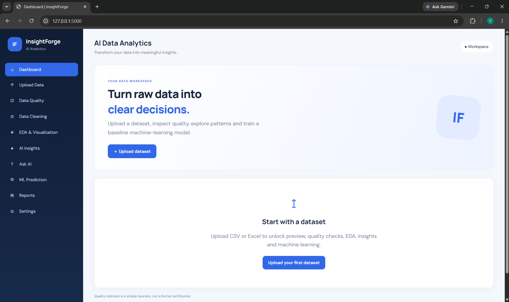

# ✨ InsightForge AI
### AI-Powered Data Analytics & Insights Platform

**Turn raw data into meaningful insights.**

InsightForge AI is an interactive data analytics web application built with Python, Flask, and Pandas. It helps users upload datasets, explore data, identify data quality issues, generate visualizations, and interact with an AI-powered data assistant through a clean and modern interface.

The goal of this project is to make data analysis easier, faster, and more accessible through a single platform.

---

## 🚀 Key Features

- **Dataset Upload** – Upload CSV and Excel datasets for analysis.
- **Dataset Preview** – Explore rows, columns, and dataset information.
- **Exploratory Data Analysis (EDA)** – Understand data through statistics and visualizations.
- **Data Cleaning** – Handle missing values and improve dataset quality.
- **AI Insights** – Generate meaningful observations from uploaded data.
- **Ask AI** – Interact with a data assistant using natural language questions.
- **ML Prediction** – Perform baseline machine learning analysis.
- **Report Generation** – Generate structured analytical reports.
- **Modern Dashboard** – Clean, responsive, and user-friendly interface.
- **Settings** – Manage application preferences and appearance.

---


## 📸 Project Screenshots

Explore the different modules of InsightForge AI.

### 1. Dashboard


### 2. Dataset Upload


### 3. Exploratory Data Analysis


### 4. Data Cleaning


### 5. AI Insights


### 6. Ask AI


### 7. Machine Learning Prediction


### 8. Reports


## 🛠️ Tech Stack

| Technology | Purpose |
|---|---|
| Python | Core programming language |
| Flask | Backend web framework |
| Pandas | Data processing and analysis |
| NumPy | Numerical computations |
| HTML5 | Web page structure |
| CSS3 | UI styling and layout |
| JavaScript | Frontend interactions |
| Plotly | Interactive data visualizations |
| Scikit-learn | Machine learning analysis |
| Jinja2 | Dynamic HTML templates |

---

## 🔄 How It Works

```text
        Upload Dataset
              |
              v
       Dataset Processing
              |
              v
       Dataset Preview
              |
              v
    Exploratory Data Analysis
              |
              v
        Data Cleaning
              |
              v
        AI Insights
              |
        +-----+------+
        |            |
        v            v
      Ask AI     ML Prediction
        |            |
        +-----+------+
              |
              v
       Generate Reports
              |
              v
       Meaningful Insights
```

---

## ⚙️ Installation & Setup

### 1. Clone the Repository

```bash
git clone https://github.com/YOUR_USERNAME/YOUR_REPOSITORY.git
```

### 2. Navigate to the Project Folder

```bash
cd AI-Data-Analytics-Dashboard
```

### 3. Create a Virtual Environment

```bash
python -m venv venv
```

### 4. Activate Virtual Environment

**Windows PowerShell:**

```powershell
.\venv\Scripts\Activate.ps1
```

### 5. Install Dependencies

```bash
pip install -r requirements.txt
```

### 6. Run the Application

```bash
python app.py
```

### 7. Open in Browser

```text
http://127.0.0.1:5000
```

---

## 📁 Project Structure

```text
AI-Data-Analytics-Dashboard/
│
├── app.py
├── requirements.txt
│
├── templates/
│   ├── base.html
│   ├── dashboard.html
│   ├── upload.html
│   ├── eda.html
│   ├── data_cleaning.html
│   ├── ai_insights.html
│   ├── ask_ai.html
│   ├── ml_prediction.html
│   ├── reports.html
│   └── settings.html
│
├── static/
│   ├── css/
│   │   └── style.css
│   └── js/
│
├── screenshots/
│   ├── dashboard.png
│   ├── upload.png
│   ├── eda.png
│   ├── data-cleaning.png
│   ├── ask-ai.png
│   ├── ai-insights.png
│   └── reports.png
│
└── README.md
```

---

## 🎯 Project Objectives

- Build a practical end-to-end data analytics application.
- Apply Python and Pandas to real-world data processing.
- Understand data cleaning and exploratory data analysis.
- Integrate data-driven insights into a web application.
- Explore the application of machine learning in analytics.
- Develop a professional and user-friendly dashboard.

---

## 🔮 Future Improvements

- Advanced AI-powered analytical recommendations.
- More machine learning algorithms.
- Automated data visualization suggestions.
- Advanced predictive analytics.
- Export reports in PDF and Excel formats.
- Improved AI question-answering capabilities.
- User authentication and database integration.

---

## 📚 What I Learned

While developing InsightForge AI, I gained practical experience in:

- Python-based application development.
- Flask backend development.
- Data manipulation using Pandas.
- Building interactive dashboards.
- Working with HTML, CSS, and JavaScript.
- Integrating analytical and machine learning workflows.
- Organizing and managing a complete GitHub project.

---

## 👨‍💻 Author

**Vivek**

Data Science Student | Python Developer | Aspiring Data Analyst

This project was developed as a practical learning experience to explore the combination of data science, web development, and AI-powered analytics.

---

## ⭐ Support

If you find this project interesting, consider giving it a ⭐ on GitHub!

**InsightForge AI – From Raw Data to Real Insights.**